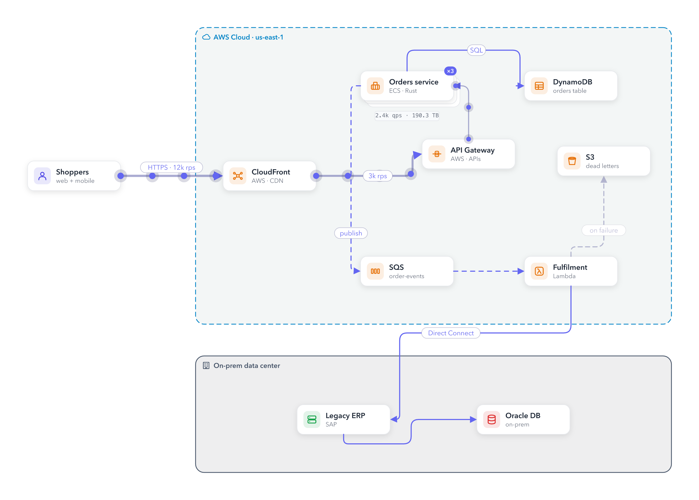
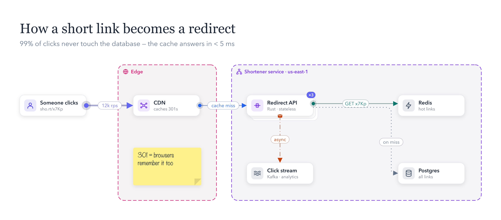

<p align="center"></p>

<h1 align="center">idraw</h1>

<p align="center"><b>Diagrams that move.</b> A fast, open-source diagramming app for macOS, built for system design.<br>
Excalidraw's simplicity, draw.io's depth, plus animated request flows you can export as GIFs.</p>

<p align="center">
  <a href="https://github.com/sattamBytes/idraw/releases/latest"></a>
  
  
  
  <a href="LICENSE"></a>
</p>

<p align="center"></p>

## Install

**Homebrew**

```bash
brew install --cask sattamBytes/tap/idraw
```

Prefer the short name? Tap and trust once, then it's just `idraw`:

```bash
brew tap sattamBytes/tap
brew trust sattamBytes/tap
brew install --cask idraw      # later: brew upgrade --cask idraw
```

**Or download** the latest `idraw-…-macos-universal.zip` from [Releases](https://github.com/sattamBytes/idraw/releases/latest), unzip it, and drag **idraw.app** into Applications.

> **First launch:** idraw isn't notarized by Apple yet, so macOS may say it "can't be opened". Right-click idraw.app and choose **Open**, then **Open** again. You only have to do this once. Homebrew installs skip this step.

**Or build from source** (Rust 1.85+):

```bash
git clone https://github.com/sattamBytes/idraw && cd idraw
scripts/bundle.sh --install   # builds idraw.app into ~/Applications
```

<p align="center"></p>

## For AI agents and scripts

`.idraw` files are plain JSON that's easy to write by hand: string ids, `"from": "api"` connectors, `#hex` colours, boundary presets, and defaults for everything else. The `idraw` command renders and checks them, so an agent can draw, look at the picture and fix it:

```bash
idraw render diagram.idraw         # → diagram.png  (-o out.svg | out.gif, --dark, --4k)
idraw check diagram.idraw          # bad ids, unknown icons, overlaps, text that won't fit
idraw icons kafka                  # find icon ids
```

### Install the idraw skill in your AI agent

The [idraw skill](skills/idraw) teaches an agent the file format, layouts that read well, and a render → look → refine loop. It uses the open [Agent Skills](https://agentskills.io) format, so one copy works across tools.

**One command** (installs into every tool it finds on your Mac):

```bash
idraw skill install            # your user folders: Claude Code, Cursor, Codex, Gemini CLI, Antigravity, VS Code Copilot
idraw skill install --project  # just this repo: .agents/skills and .claude/skills
```

Then restart the agent and ask: *"draw an idraw diagram of how our checkout works"*.

**Or copy the folder yourself.** Put `skills/idraw` (the folder containing `SKILL.md`) here:

| Tool | Your user folder | Inside a project |
|---|---|---|
| Claude Code | `~/.claude/skills/idraw` | `.claude/skills/idraw` |
| Cursor | `~/.cursor/skills/idraw` (also reads `~/.claude/skills`) | `.cursor/skills/idraw` or `.agents/skills/idraw` |
| OpenAI Codex | `~/.agents/skills/idraw` | `.agents/skills/idraw` |
| Gemini CLI | `~/.gemini/skills/idraw` or `~/.agents/skills/idraw` | `.gemini/skills/idraw` or `.agents/skills/idraw` |
| Google Antigravity | `~/.gemini/config/skills/idraw` (Antigravity 2.0) | `.agents/skills/idraw` |
| VS Code / GitHub Copilot | `~/.copilot/skills/idraw` (turn on `chat.useAgentSkills` if needed) | `.github/skills/idraw` or `.agents/skills/idraw` |
| Others (OpenCode, Goose, Kiro, Roo…) | `~/.agents/skills/idraw` usually works | `.agents/skills/idraw` |

The agent also needs the `idraw` command on its PATH (Homebrew sets this up). See [`skills/idraw/reference.md`](skills/idraw/reference.md) for every field.

<p align="center"></p>

## Features

**Draw**
- Infinite canvas: trackpad pan, pinch or ⌘-scroll to zoom, dot grid, alignment guides
- Shapes, text, freehand pen, **sticky notes**, **comments**, dashed group regions
- Labels go anywhere: a 3×3 position picker, inside or outside the shape, and they glide into place when moved
- **Clean** or **sketch** (hand-drawn, hachure fills) style, in **light** or **dark** theme

**System design**
- 250+ components: generic infra, plus **AWS, Google Cloud, Azure, Cloudflare**, other clouds and open-source services, all drawn as consistent glyphs
- **Boundary presets**: Cloud, On-prem data center, Region, AZ, VPC, public/private subnet, K8s cluster, DMZ, corporate network, edge, account
- **Bring your own icons**: drop SVG packs (e.g. the official AWS/Azure/GCP sets, under their own licences) into `~/Library/Application Support/idraw/icons/<Category>/`
- **Smart connectors** route around other shapes, snap to sides, and use elbow, straight or curved lines with label pills
- **Quick-connect**: drag from a shape's blue anchor onto empty canvas and pick what to create
- **Notes** on components (shown on hover, or under the card), **replicas** (×N stacked cards) and **capacity math** (QPS, payload, retention → bandwidth, storage, $/month)

**Animate & tell the story**
- **Flow animation** on connectors (packets or marching dashes), at Slow / Normal / Fast speed
- **Traffic-weighted edges**: label a connector "1.2k rps" and it gets thicker and faster
- **Scenarios**: record a request path by clicking components, add captions, then play it back with a travelling packet and pulses, or export it as a GIF
- **Outage simulation** (F): click components to take them down. Their connections stop, and **backup paths** take over

**Speed**
- **⌘K command palette**: commands, components, and jump to any element
- **/** inserts a component at the cursor
- **Auto-layout** (⇧⌘L or menu): animated layered layout that refits regions
- **Pen** with a one-click **Clear all drawings**
- **Diagram as code** (⌘/): a text pane with two-way sync. Paste **Mermaid** to convert it
- **Import** (⌘I): docker-compose, Kubernetes YAML, Terraform, Mermaid

**Share**
- Export **PNG / SVG / animated GIF** at 1×, 2× or **4K** (3840px)
- **Live collaboration**, peer-to-peer with no server: host on your network (or Tailscale) and share the address and code. Live cursors included
- Autosaves your last canvas. `.idraw` files are plain JSON

### Diagram as code

Write one connection per line, using plain names:

```text
Users -> API Gateway -> Orders service
Orders service -> Postgres : SQL        # text after ":" is the label
Orders service => Kafka                 # => animated, --> dashed, <-> both ways
Cache                                   # a component on its own
Payments [aws-lambda] (card processing) # optional [icon] and (subtitle)
```

Names like S3, Lambda, BigQuery or Postgres get their icon automatically. Renaming a line renames the component.

## Development

```bash
cargo run --release -- examples/hybrid-cloud.idraw   # run with a sample diagram
cargo test                                            # unit tests
scripts/bundle.sh --universal                         # universal idraw.app + release zip in dist/
```

Releases are built by GitHub Actions: push a tag like `v0.2.0` and the universal zip is attached to the GitHub release.

## Shortcuts

| Key | Action | Key | Action |
|---|---|---|---|
| V / H | select / hand | ⌘Z / ⇧⌘Z | undo / redo |
| R / O / D | rect / ellipse / diamond | ⌘D | duplicate |
| S / C | sticky note / comment | ⌘K | command palette |
| F | outage simulation | ⌘/ | diagram as code |
| / | insert component at cursor | ⇧⌘L | auto-layout |
| ⇧⌘D | dark mode | ⇧⌘K | sketch style |
| A | connector | ⌘G | wrap selection in region |
| T / P / G | text / pen / region | ⌘S / ⌘O | save / open |
| L | toggle library | ⌘E / ⇧⌘E | export PNG / GIF |
| Space-drag | pan | ⇧1 | zoom to fit |
| double-click | edit label / new text | ⌘ while dragging | disable snapping |

## Contributing

Issues and pull requests are welcome. Ideas, bugs and icon packs especially.

## License

MIT
