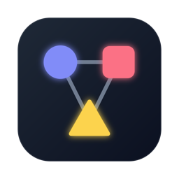
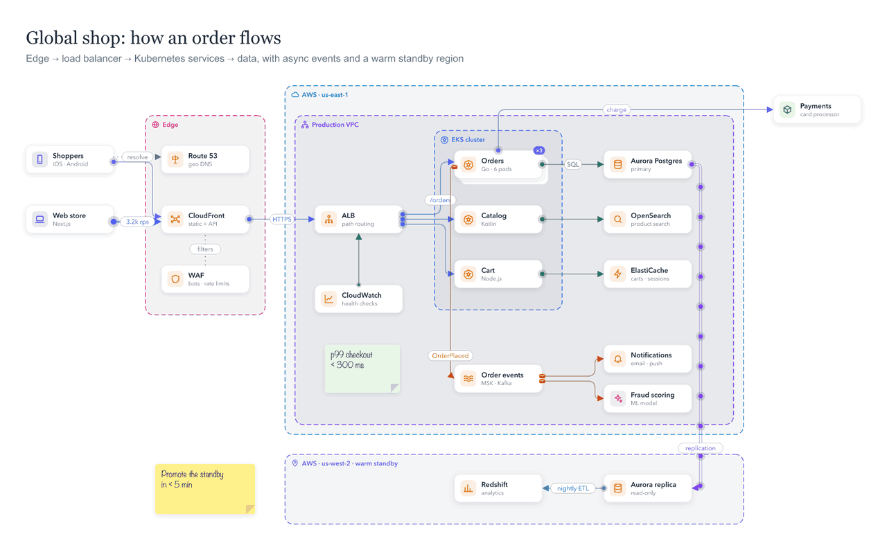
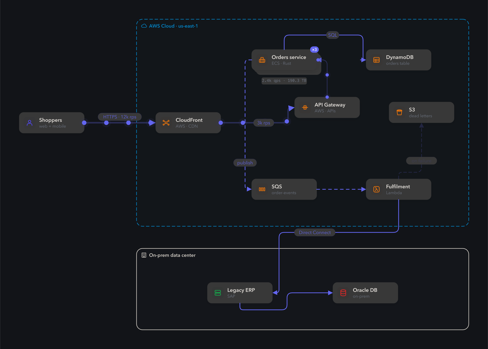
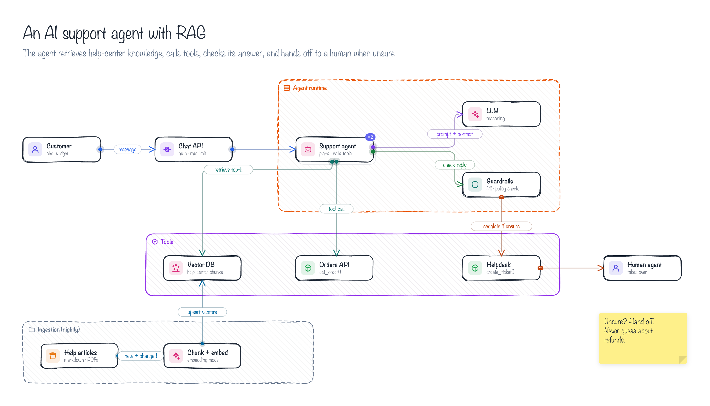
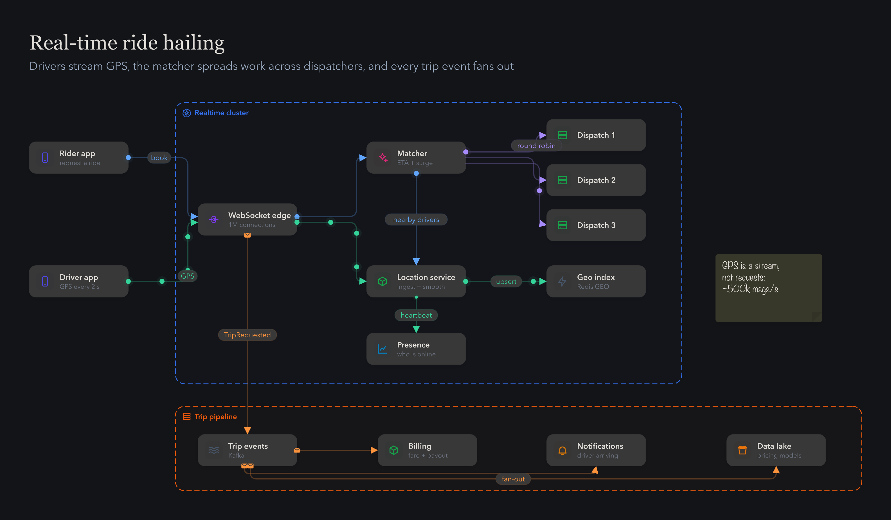
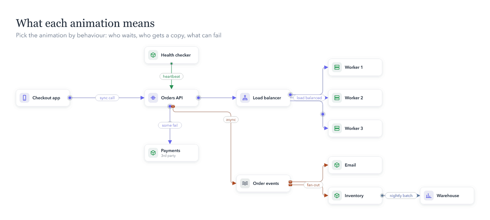

<p align="center"></p>

<h1 align="center">idraw</h1>

<p align="center"><b>The AI-first diagramming app.</b><br>
Ask your AI agent to draw your system. idraw makes it look designed, and makes it move.</p>

<p align="center">
  <a href="https://github.com/sattamBytes/idraw/releases/latest"></a>
  <a href="#draw-with-ai-in-60-seconds"></a>
  
  
  <a href="LICENSE"></a>
</p>

<p align="center"></p>

<p align="center">
  <a href="#draw-with-ai-in-60-seconds">Draw with AI</a> ·
  <a href="#why-idraw">Why idraw</a> ·
  <a href="#gallery">Gallery</a> ·
  <a href="#install">Install</a> ·
  <a href="#features">Features</a>
</p>

## Draw with AI in 60 seconds

```bash
brew install --cask sattamBytes/tap/idraw   # app + `idraw` command
idraw skill install                          # teach your agents idraw
```

Restart your agent and ask:

> *"Draw an idraw diagram of how our checkout works: web and mobile clients, an API gateway, the orders service on Kubernetes, Postgres with a read replica, and Kafka fanning out to email and fraud scoring. Animate the request path."*

You get a `.idraw` file and a rendered PNG. Double-click the file to open it in idraw, play the animations, and keep editing by hand or by asking for changes.

Works with **Claude Code · Cursor · OpenAI Codex · Gemini CLI · Google Antigravity · VS Code Copilot**, and any tool that reads the open [Agent Skills](https://agentskills.io) format.

**How the agent gets it right.** Most AI diagrams look messy because the model can't see what it drew. idraw gives it eyes and a checklist:

```
write → idraw check → fix → idraw render → look → fix → done
```

`idraw check` doesn't just say "something's wrong". It names the problem and the exact fix:

```text
layout: "api" and "cache" are 20px off the same row, which bends the line between them: set y of "cache" to 220
layout: line api → db leaves or enters from the wrong side: pin it with "from": {"id": "api", "side": "right"} …
layout: label of line api → db "on miss" sits on "db": set "label_t": 0.3 (now 0.97)
```

Every diagram in the [gallery](#gallery) was drawn this way, by an agent, in two or three passes.

## Why idraw

**🤖 Built for AI agents.** A forgiving file format that's easy to write (string ids, `"from": "api"`, `#hex` colours, boundary presets, sensible defaults). A command line that renders PNG/SVG/GIF and checks layout. A skill that teaches agents good diagram design. One command installs it into six tools.

**🎞 Animations that mean something.** Not decoration: each animation says how two systems talk. A request and its reply, fire-and-forget messages, fan-out to every subscriber, load-balanced turns, heartbeats, requests that fail. Export any of it as a GIF.

**🏗 System design out of the box.** 290+ icons for AWS, Google Cloud, Azure, Cloudflare and open source, plus logic, AI and product icons. Boundary presets for clouds, VPCs, subnets and clusters. Outage simulation, backup paths, replicas and capacity math.

**⚡ Native, fast and free.** A real Mac app written in Rust. Works offline, no account, no subscription, MIT licensed. Diagrams are plain JSON files that live happily in git.

## Gallery

Each of these is a plain `.idraw` file in [`examples/`](examples), written by an AI agent with the idraw skill. Open one to play its animations, or run `idraw render`.

<p align="center"></p>

<table>
<tr>
<td width="50%"><br><b>AI support agent with RAG</b>: sketch style · <a href="examples/ai-support-agent.idraw">file</a></td>
<td width="50%"><br><b>Real-time ride hailing</b>: dark mode · <a href="examples/ride-hailing.idraw">file</a></td>
</tr>
</table>

**What each animation means**

<p align="center"></p>

| Animation | Meaning | Use it for |
|---|---|---|
| Request → reply | the caller waits; a hollow reply comes back | user → API, service → database |
| Async message | envelopes fly one way, several at a time | service → queue, webhooks |
| Stream | a steady flow of data | events, logs, replication |
| Batch | bursts with pauses | nightly ETL, bulk sync |
| Fan-out | every subscriber gets a copy at once | pub/sub topics |
| Load balanced | targets take turns | load balancers, worker pools |
| Heartbeat | a ping and an "ok" ripple | health checks |
| Some fail | a red ✕ drops off the line | flaky dependencies, rate limits |

## Install

**Homebrew** (recommended: also installs the `idraw` command)

```bash
brew install --cask sattamBytes/tap/idraw
```

**Update**

```bash
brew update && brew upgrade --cask sattamBytes/tap/idraw
```

> Still on an old version after upgrading? Your copy of the tap hasn't refreshed: run `git -C "$(brew --repo sattamBytes/tap)" pull`, then upgrade again. (`brew reinstall` never looks for new versions.)

**Download:** grab `idraw-…-macos-universal.zip` from [Releases](https://github.com/sattamBytes/idraw/releases/latest) and drag **idraw.app** into Applications. idraw isn't notarized by Apple yet, so the first time, right-click the app → **Open** → **Open**. Homebrew installs skip this.

**Build from source** (Rust 1.85+):

```bash
git clone https://github.com/sattamBytes/idraw && cd idraw
scripts/bundle.sh --install   # builds idraw.app into ~/Applications and links the idraw command
```

Double-click any `.idraw` file (or right-click → **Open With → idraw**) to open it. If Finder doesn't offer idraw yet, open the app once so macOS registers it.

<details>
<summary><b>Prefer the short name <code>brew install --cask idraw</code>?</b></summary>

```bash
brew tap sattamBytes/tap
brew trust sattamBytes/tap
brew install --cask idraw      # later: brew upgrade --cask idraw
```

</details>

## For AI agents

### The `idraw` command

```bash
idraw render diagram.idraw        # → diagram.png (2x). Also -o out.svg | out.gif, --dark, --4k, --failures
idraw check diagram.idraw         # broken ids, unknown icons, plus layout issues with exact fixes
idraw icons kafka                 # find icon ids: idraw icons aws queue
idraw skill install [--project]   # add the idraw skill to your agents
```

### The file format

Plain JSON, forgiving by design. This is a complete, valid diagram:

```json
{
  "elements": [
    { "kind": "region", "preset": "vpc", "title": "Production VPC", "x": 280, "y": 40, "w": 760, "h": 420 },
    { "kind": "node", "id": "users", "icon": "user", "title": "Users", "subtitle": "web + mobile", "x": 40, "y": 220 },
    { "kind": "node", "id": "api", "icon": "gateway", "title": "API Gateway", "x": 340, "y": 220 },
    { "kind": "node", "id": "db", "icon": "oss-postgres", "title": "Postgres", "x": 760, "y": 220 },
    { "kind": "edge", "from": "users", "to": "api", "text": "HTTPS", "flow": "request" },
    { "kind": "edge", "from": "api", "to": "db", "text": "SQL", "flow": "request" }
  ]
}
```

Every field is in [`skills/idraw/reference.md`](skills/idraw/reference.md).

### Install the skill by hand

`idraw skill install` does this for you. To copy [`skills/idraw`](skills/idraw) (the folder with `SKILL.md`) yourself:

| Tool | Your user folder | Inside a project |
|---|---|---|
| Claude Code | `~/.claude/skills/idraw` | `.claude/skills/idraw` |
| Cursor | `~/.cursor/skills/idraw` (also reads `~/.claude/skills`) | `.cursor/skills/idraw` or `.agents/skills/idraw` |
| OpenAI Codex | `~/.agents/skills/idraw` | `.agents/skills/idraw` |
| Gemini CLI | `~/.gemini/skills/idraw` or `~/.agents/skills/idraw` | `.gemini/skills/idraw` or `.agents/skills/idraw` |
| Google Antigravity | `~/.gemini/config/skills/idraw` (Antigravity 2.0) | `.agents/skills/idraw` |
| VS Code / GitHub Copilot | `~/.copilot/skills/idraw` (turn on `chat.useAgentSkills` if needed) | `.github/skills/idraw` or `.agents/skills/idraw` |
| Others (OpenCode, Goose, Kiro, Roo…) | `~/.agents/skills/idraw` usually works | `.agents/skills/idraw` |

<details>
<summary><b>Troubleshooting: <code>idraw</code> prints nothing or isn't found</b></summary>

1. Check the version (the command line arrived in 0.3.0):
   ```bash
   brew update && brew upgrade --cask sattamBytes/tap/idraw
   brew info --cask sattamBytes/tap/idraw | head -1
   ```
2. Run the app's binary directly. If this works, the problem is only which `idraw` your shell finds:
   ```bash
   /Applications/idraw.app/Contents/MacOS/idraw --help
   /Applications/idraw.app/Contents/MacOS/idraw skill install
   ```
   (Installed elsewhere? Use `~/Applications/idraw.app/...` or the folder you passed to `--appdir`.)
3. See which `idraw` runs and where it points:
   ```bash
   which -a idraw
   ls -l "$(which idraw)"
   ```
   If another `idraw` comes first, or Homebrew lives in a custom folder that isn't on your PATH, add a link yourself:
   ```bash
   mkdir -p ~/.local/bin && ln -sf /Applications/idraw.app/Contents/MacOS/idraw ~/.local/bin/idraw
   ```
   and make sure `~/.local/bin` is on your PATH (`echo 'export PATH="$HOME/.local/bin:$PATH"' >> ~/.zshrc`, then open a new terminal).
4. `idraw --help` should list `render`, `check`, `icons` and `skill`. If it opens the app window instead, you're running a version older than 0.3.0.

</details>

## Features

Excalidraw's simplicity with draw.io's depth, in a native app.

**Draw**
- Infinite canvas: drag empty space or use the trackpad to pan, pinch or ⌘-scroll to zoom, alignment guides
- Shapes, text, freehand pen, **sticky notes**, **comments** and boundaries, with properties docked on the left and components on the right
- Labels and icons go anywhere on a shape (3×3 position pickers); long titles wrap and cards grow to fit
- Line styles (solid, dashed, dotted, dash-dot, double), per-item **font** (clean, hand-drawn, code, serif) and **text colour**
- **Clean** or **sketch** (hand-drawn) style, in **light** or **dark** theme

**System design**
- 290+ components: generic infra, **AWS, Google Cloud, Azure, Cloudflare**, other clouds and open source
- **Logic, AI and idea icons**: decision, decision tree, router, if/else, switch, merge/split, loop, rule engine, feature flag, A/B test, state machine; prompt, tokens, temperature, embeddings, RAG, guardrails, evals, agent memory, tool calls; idea, design, goal, launch
- **Boundary presets**: cloud, on-prem, region, AZ, VPC, public/private subnet, Kubernetes cluster, DMZ, corporate network, edge, account
- **Smart connectors** route around shapes, snap to 12 connection points, hop over crossings and spread overlapping lines into lanes
- **Notes** on components, **replicas** (×N stacked cards) and **capacity math** (QPS, payload, retention → bandwidth, storage, $/month)
- **Bring your own icons**: drop SVG packs into `~/Library/Application Support/idraw/icons/<Category>/`

**Animate & tell the story**
- **Flow animations by meaning** (table above) at Slow / Normal / Fast; label a line "1.2k rps" and it gets thicker and faster
- **Scenarios**: click through a request path, add captions, play it back or export it as a GIF
- **Outage simulation** (F): take components down; their connections stop and **backup paths** take over

**Speed**
- **⌘K command palette** and **/** to insert a component at the cursor
- **Diagram as code** (⌘/) with two-way sync; paste **Mermaid** to convert it
- **Import** (⌘I) docker-compose, Kubernetes YAML, Terraform and Mermaid
- **Auto-layout** (⇧⌘L)

**Share**
- Export **PNG / SVG / animated GIF** up to **4K**, or **copy as image** (⇧⌘C) straight into Slack or Docs
- **Live collaboration**, peer-to-peer with no server: host on your network (or Tailscale), share the address and code
- Autosave, and `.idraw` files open from Finder with a double-click

### Diagram as code

One connection per line, using plain names:

```text
Users -> API Gateway -> Orders service
Orders service -> Postgres : SQL        # text after ":" is the label
Orders service *> Kafka                 # >> request/reply, *> async, => stream, --> dashed, <-> both ways
Cache                                   # a component on its own
Payments [aws-lambda] (card processing) # optional [icon] and (subtitle)
```

Names like S3, Lambda, BigQuery or Postgres get their icon automatically.

## Shortcuts

| Key | Action | Key | Action |
|---|---|---|---|
| V / H | select / hand | ⌘Z / ⇧⌘Z | undo / redo |
| R / O / D | rect / ellipse / diamond | ⌘D | duplicate |
| S / C | sticky note / comment | ⌘K | command palette |
| A | connector | ⌘/ | diagram as code |
| T / P / G | text / pen / region | ⇧⌘L | auto-layout |
| / | insert component at cursor | ⌘G | wrap selection in region |
| F | outage simulation | ⇧⌘D / ⇧⌘K | dark mode / sketch style |
| L | toggle components | ⌘] / ⌘[ | bring forward / send backward |
| drag empty space | pan | ⇧ + drag | box-select |
| double-click | edit label / new text | ⌘S / ⌘O | save / open |
| ⇧1 | zoom to fit | ⌘E / ⇧⌘E | export PNG / GIF |
| ⇧⌘C | copy as image | ⌘ while dragging | disable snapping |

## Development

```bash
cargo run --release -- examples/global-shop.idraw    # run with a sample diagram
cargo test                                            # unit tests
scripts/bundle.sh --universal                         # universal idraw.app + release zip in dist/
```

Publishing a GitHub release builds and attaches the universal zip automatically.

## Contributing

Issues and pull requests are welcome, especially ideas, bugs, icon packs and example diagrams. If you draw something great with your agent, send it in for the gallery.

## License

MIT
